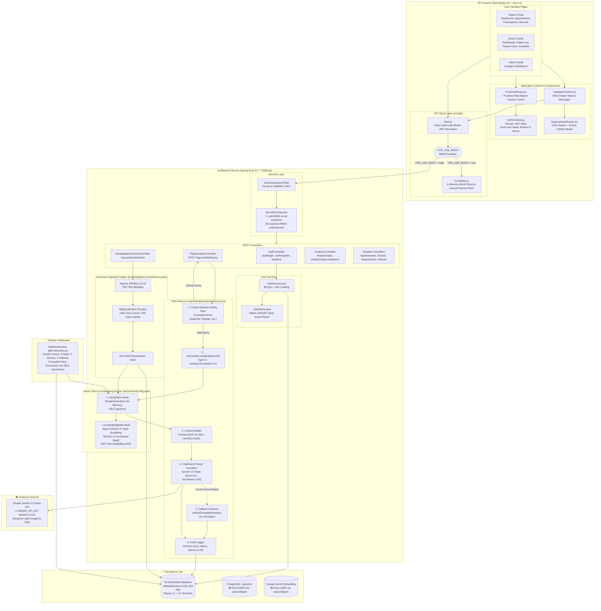
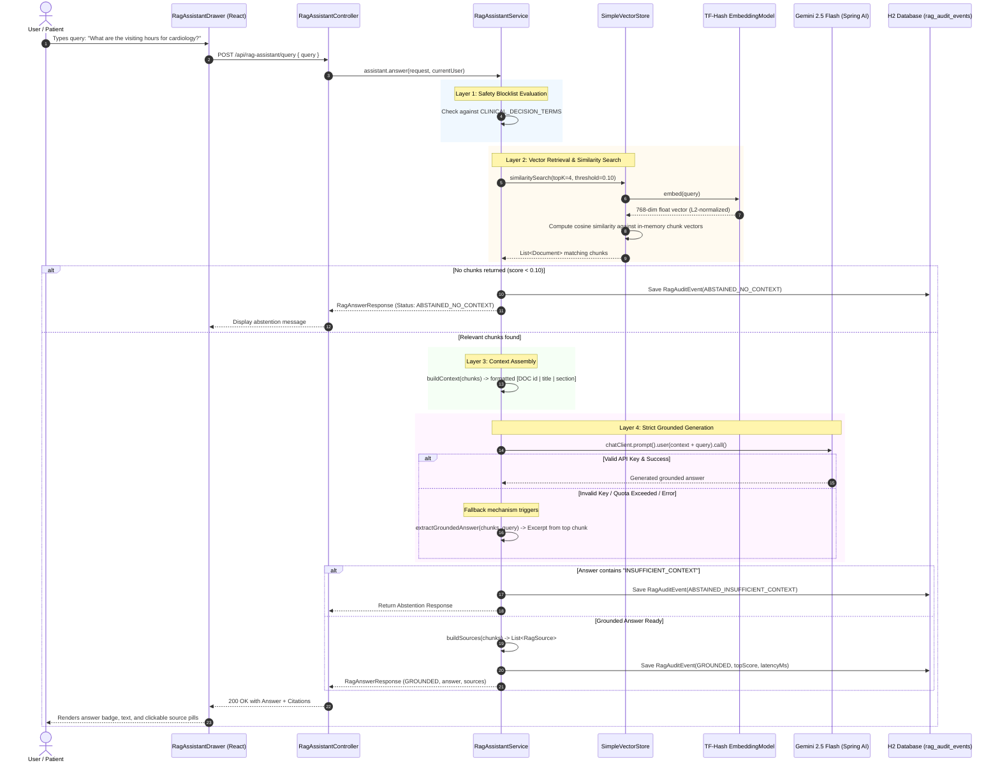
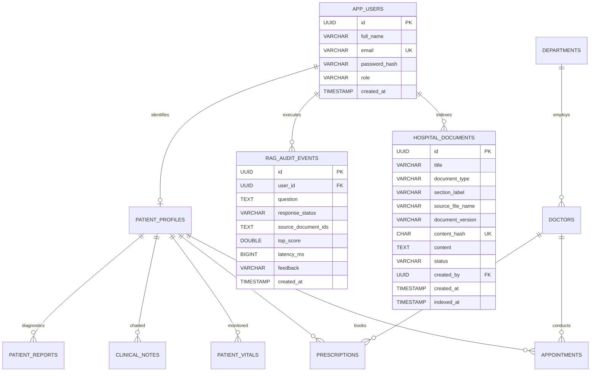

# ApexCare Hospital Management System — Architecture Diagram
### System: React 18 SPA + Spring Boot 3.5.7 + RAG Pipeline (Gemini 2.5 Flash / TF-Hash Embedding / SimpleVectorStore)

---

## 1. Complete System Architecture Diagram

---

## 2. RAG Execution Flow Diagram

---

## 3. Data Storage and Model Diagram

