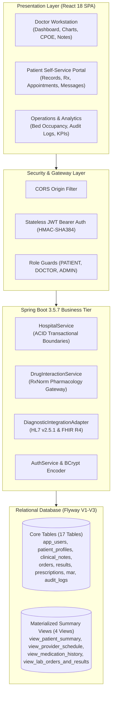

# CareConnect — Patient-Provider Electronic Health Record System (EHRS01)

[](https://www.oracle.com/java/)
[](https://spring.io/projects/spring-boot)
[](https://react.dev/)
[](https://vitejs.dev/)
[](https://flywaydb.org/)
[](#running-tests)
[](#diagnostic-interoperability)

> **Official Repository:** [https://github.com/scrollingreel/P_003-CareConnect-Patient-EHR-HCL-TECH-PROJECT](https://github.com/scrollingreel/P_003-CareConnect-Patient-EHR-HCL-TECH-PROJECT)  
> **Project Code:** `EHRS01`  
> **Domain:** Healthcare and Pharma  
> **Author / Student Name:** Utkarsh Gupta  
> **Roll Number:** 2300320150065  
> **Branch:** Computer Engineering  
> **College / Institution:** ABES ENGINEERING COLLEGE GHAZIABAD UTTAR PRADESH  
> **College Email ID:** utkarsh.23b0151019@abes.ac.in  
> **Evaluation Sponsoring Entity:** Academic Center of Excellence (COE) / HCL Healthcare Technologies Practice  
> **Methodology:** Agile / Scrum (4 Sprints)

---

## 1. Project Overview & Description

**CareConnect (Project Code: EHRS01)** is an enterprise-grade Electronic Health Record (EHR) and clinical workflow orchestration platform designed to streamline healthcare delivery across outpatient, inpatient, diagnostic, and patient self-service environments.

Modern healthcare operations frequently suffer from:
1. **Fragmented Patient Records:** Crucial medical histories, allergies, and diagnostic results are scattered across disparate software silos.
2. **Manual Paper Documentation:** Vulnerable to silent overwriting, lack of standardized specialty templates, and missing audit trails.
3. **Adverse Drug Events:** Inadvertent prescribing of contraindicated drug combinations due to absent point-of-care pharmacology safety checks.
4. **Delayed Critical Interventions:** Diagnostic abnormalities (e.g., severe hypokalemia or elevated cardiac troponin) stalling in technician queues without automated physician panic alerting.
5. **Patient Disengagement:** Patients lacking secure, transparent access to released encounter summaries, active prescriptions, and direct clinical communication.

CareConnect solves these critical challenges by unifying **Patient Registration**, **Clinical Encounter Charting**, **Computerized Provider Order Entry (CPOE)**, **Medication Administration Records (MAR)**, **Drug-Drug Interaction (DDI) Safety Checks**, **Diagnostic Results with Critical Panic Alerts**, and an engaging **Patient Self-Service Portal** into an integrated, role-governed application.

---

## 2. Mandatory HCL Project Epics

CareConnect satisfies all seven (7) mandatory HCL Epics:

| Epic | Clinical & Technical Functionality | Key Components & Endpoints |
|---|---|---|
| **Epic 1: Patient Registration & Demographics** | Digital onboarding, demographic profiling, insurance policy tracking, chronic condition collection, and patient search directory. | `PatientRecordController`, `patient_profiles`, `/api/records/patient-profile` |
| **Epic 2: Clinical Documentation** | Multi-specialty templated documentation (SOAP, Cardiology, Discharge), Assessment/Plan separation, and tamper-resistant digital signing enforcing HTTP 409 Conflict on finalized notes. | `PatientRecordController`, `clinical_notes`, `/api/patients/{id}/clinical-notes` |
| **Epic 3: Computerized Provider Order Entry (CPOE)** | Standardized ordering for laboratory tests (LOINC coded), diagnostic imaging (MRI, CT, Ultrasound), and clinical procedures with lifecycle status tracking (PLACED ➔ IN_PROGRESS ➔ COMPLETED). | `CpoeController`, `lab_orders`, `imaging_orders`, `procedure_orders`, `/api/orders/*` |
| **Epic 4: Medication Management** | Electronic prescribing, medication reconciliation, nurse-verified Medication Administration Records (MAR: Given, Held, Refused), and RxNorm-aligned Drug-Drug Interaction contraindication screening. | `PrescriptionController`, `DrugInteractionService`, `medication_administrations`, `/api/prescriptions/*` |
| **Epic 5: Lab & Imaging Integration** | Diagnostic result retrieval, reference range evaluation, automated critical panic alerts, and standards-compliant HL7 v2.5.1 (ORU^R01) and HL7 FHIR Release 4 JSON payload adapters. | `IntegrationController`, `DiagnosticIntegrationAdapter`, `lab_results`, `/api/integrations/*` |
| **Epic 6: System Integration & Audit** | Cross-module entity linkage connecting patients, encounters, orders, prescriptions, and results within ACID transactional boundaries, accompanied by an immutable audit log. | `HospitalService` (`@Transactional`), `audit_logs`, `patient_notifications` |
| **Epic 7: Patient Portal** | Authenticated patient self-service for reviewing released clinical records, tracking active prescriptions, booking appointments, and engaging in secure patient-provider clinical messaging. | `CommunicationController`, `AppointmentController`, `secure_messages`, `/api/messages` |

---

## 3. System Architecture



---

## 4. Technology Stack

### Backend
- **Runtime:** Java 24 / OpenJDK 21+
- **Framework:** Spring Boot 3.5.7 (Spring Web, Spring Security 6.4, Spring Data JPA / Hibernate 6.6)
- **Database Engine:** Relational Database (H2 PostgreSQL Dialect Mode / PostgreSQL 16 ready)
- **Database Migrations:** Flyway 10.15 (Migrations `V1`, `V2`, `V3`)
- **Interoperability:** HL7 v2.5.1 Pipe & Hat format, HL7 FHIR Release 4 JSON specification
- **Testing:** JUnit 5, Spring Boot Test, Spring Security Test, MockMvc, AssertJ, Maven Surefire 3.5.4

### Frontend
- **Library:** React 18.3
- **Build Tool:** Vite 5.4
- **Routing:** React Router DOM 6.26
- **Data Fetching:** TanStack React Query 5.56
- **Styling:** Tailwind CSS 3.4
- **Icons:** Lucide React

---

## 5. How to Run the Project

### Prerequisites
Ensure the following tools are installed on your workstation:
1. **Java Development Kit (JDK):** Oracle JDK 24 or OpenJDK 21+ ([Download](https://www.oracle.com/java/technologies/downloads/))
2. **Node.js:** Node.js v18+ or v22+ and npm ([Download](https://nodejs.org/))
3. **Apache Maven:** Maven 3.9+ (A pre-configured binary is included in `backend/.tools/apache-maven-3.9.9/`)
4. **Git:** Git 2.30+

---

### Step 1: Clone the Repository
```bash
git clone https://github.com/scrollingreel/P_003-CareConnect-Patient-EHR-HCL-TECH-PROJECT.git
cd P_003-CareConnect-Patient-EHR-HCL-TECH-PROJECT
```

---

### Step 2: Configure Environment Variables
A default `.env` file is included in the project root:
```env
VITE_USE_MOCK=false
VITE_API_BASE_URL=http://localhost:8080/api
```
*(No modification is necessary for local testing; backend runs on port `8080` with servlet path `/api`, and frontend runs on port `3000`)*.

---

### Step 3: Run the Spring Boot Backend

#### On Windows (PowerShell):
```powershell
# Set JAVA_HOME to JDK 21 or 24
$env:JAVA_HOME = "C:\Program Files\Java\jdk-24"

# Navigate to backend
cd backend

# Start Spring Boot application
.tools\apache-maven-3.9.9\bin\mvn.cmd spring-boot:run
```

#### On Linux / macOS (Bash):
```bash
cd backend
mvn spring-boot:run
```

The backend server will start on:  
`http://localhost:8080/api`

Backend startup output will confirm:
```text
Tomcat started on port 8080 (http) with context path '/api'
Started HospitalRagApplication in ~10.5 seconds
```

---

### Step 4: Run the React Frontend

Open a second terminal window:

```bash
# Navigate to repository root
cd P_003-CareConnect-Patient-EHR-HCL-TECH-PROJECT

# Install dependencies (if not already installed)
npm install

# Start Vite development server
npm run dev
```

The frontend application will start on:  
`http://localhost:3000/`

Open your web browser and navigate to `http://localhost:3000/`.

---

## 6. Default Demo Accounts & Personas

For immediate demonstration and evaluation, pre-seeded accounts with appropriate roles are available:

| Persona | Role | Email | Password | Primary Features Available |
|---|---|---|---|---|
| **Dr. Rajesh Verma** | `DOCTOR` | `doctor@apexcare.org` | `DoctorPass2026!` | Clinical workstation, Patient Charts, SOAP Notes, CPOE Orders, Prescriptions, Critical Alerts |
| **Dr. Sarah Jenkins** | `DOCTOR` | `sarah.jenkins@apexcare.org` | `DoctorPass2026!` | Outpatient consultations, Cardiology Consults, Procedure Orders, Diagnostic Reviews |
| **Ananya Sharma** | `PATIENT` | `ananya.sharma@example.com` | `SecurePass2026!` | Patient Portal, Released Health Records, Prescription History, Appointment Scheduling, Secure Messaging |
| **Amanda Ross** | `ADMIN` | `admin@apexcare.org` | `SecurePass2026!` | Hospital Operations Analytics, Bed Occupancy, Diagnostic Turnaround Times, Immutable Audit Trail |

> **Tip:** The login screen at `http://localhost:3000/login` features one-click **Quick Demo Switcher** buttons (`Doctor`, `Patient`, `Admin`) that auto-populate credentials for testing.

---

## 7. Running Tests & Quality Verification

### Run Backend Automated Tests (15 Tests)
```powershell
$env:JAVA_HOME = "C:\Program Files\Java\jdk-24"
cd backend
.tools\apache-maven-3.9.9\bin\mvn.cmd test
```

Expected result:
```text
[INFO] Running com.apexcare.rag.CareConnectEpicTests
[INFO] Tests run: 8, Failures: 0, Errors: 0, Skipped: 0
[INFO] Running com.apexcare.rag.CareConnectWebMvcTests
[INFO] Tests run: 7, Failures: 0, Errors: 0, Skipped: 0
[INFO] Results: Tests run: 15, Failures: 0, Errors: 0, Skipped: 0
[INFO] BUILD SUCCESS
```

### Run Frontend Production Build
```bash
npm run build
```

Expected result:
```text
vite v5.4.21 building for production...
✓ 2503 modules transformed.
dist/index.html                   1.11 kB │ gzip:   0.64 kB
dist/assets/index-BBvHlIKF.css   43.18 kB │ gzip:   7.55 kB
dist/assets/index-CcylIRwq.js   898.28 kB │ gzip: 244.03 kB
✓ built in ~15s
```

---

## 8. Diagnostic Interoperability Endpoints

CareConnect includes an active interoperability gateway supporting standard healthcare exchange formats:

- **Integration Gateway Status:**  
  `GET http://localhost:8080/api/integrations/status`
- **HL7 v2.5.1 Observation Message (ORU^R01):**  
  `GET http://localhost:8080/api/integrations/hl7/oru-r01/{orderId}`
- **HL7 FHIR Release 4 DiagnosticReport & Observation JSON:**  
  `GET http://localhost:8080/api/integrations/fhir/diagnostic-report/{orderId}`

*(Note: In accordance with academic honesty guidelines, these adapters connect to a modular sandbox engine conforming to HL7 standards rather than claiming unverified commercial live hospital feeds).*

---

## 9. Academic COE Submission Package

All formal academic deliverables are generated in the `submission/` directory:

```text
submission/
├── CareConnect_Source_Code.docx          # Complete authored source code (12 sections)
├── CareConnect_Source_Code.pdf           # Vector PDF source code specification
├── CareConnect_Project_Screenshots.docx  # 19 High-resolution genuine UI screenshots
├── CareConnect_Project_Screenshots.pdf   # Visual proof document with route mappings
├── CareConnect_Project_Synopsis.docx     # Formal 25-section project synopsis
├── CareConnect_Project_Synopsis.pdf      # Publication-grade academic synopsis
├── API_Documentation.pdf                 # REST API endpoints & request/response contracts
├── Database_Schema.pdf                   # 17 Tables, 4 Views, DDL & foreign key constraints
├── HCL_Requirements_Traceability.xlsx    # Full traceability matrix (16 features COMPLETE)
├── Test_Cases.xlsx                       # 22 Test cases covering Epics 1-7
├── Test_Results.xlsx                     # Execution logs for 15 automated tests
├── Sample_Patient_Data.csv               # 10 Synthetic patient clinical fixtures
├── Deployment_Guide.pdf                  # Step-by-step local deployment instructions
├── Project_Demonstration_Guide.pdf       # 10-Step evaluator walkthrough script
└── COE_SUBMISSION_CHECKLIST.md           # Formal sign-off and verification report
```

---

## 10. Repository Directory Structure

```text
CareConnect/
├── backend/
│   ├── src/main/java/com/apexcare/rag/
│   │   ├── api/                 # REST Controllers (Cpoe, Prescription, Integration, Records)
│   │   ├── domain/              # JPA Domain Entities (ClinicalNote, LabOrder, MAR, etc.)
│   │   ├── repository/          # Spring Data JPA Repository Interfaces (21 repositories)
│   │   ├── service/             # Business Logic (HospitalService, DDI, DiagnosticAdapter)
│   │   ├── security/            # SecurityConfig, JwtAuthenticationFilter, BCrypt Encoder
│   │   └── config/              # DataSeeder, AppConfig
│   ├── src/main/resources/
│   │   ├── db/migration/        # Flyway Versioned Migrations (V1, V2, V3)
│   │   └── application.yml      # Server, Database, and CORS configuration
│   └── pom.xml                  # Maven Project Object Model (Spring Boot 3.5.7)
├── src/
│   ├── api/                     # Axios client, REST endpoints, DDI gateways
│   ├── components/              # Layouts, Navbar, Sidebar, ProtectedRoute
│   ├── context/                 # AuthContext (RBAC), AssistantContext
│   └── pages/                   # Doctor, Patient, Admin, and Auth workspaces
├── docs/                        # HCL Project Specifications & Traceability Matrices
├── submission/                  # Formal Submission Packaging & Generated Artifacts
├── .gitignore                   # Clean repository ignore rules
├── .env.example                 # Sample environment template
├── package.json                 # React 18 / Vite dependencies
└── README.md                    # Project documentation & run guide
```

---

## 11. License & Academic Attribution

This project is authored for the **Academic Center of Excellence (COE) / HCL Healthcare Technologies Practice** under the **HCL Project Olympus (EHRS01)** challenge framework. All clinical names, patient demographics, and medical values contained in demonstration datasets are synthetic test fixtures adhering strictly to privacy requirements.
